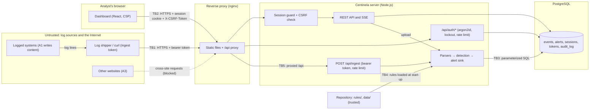

# Threat model

Centinela is a security tool that reads data written by the people it watches. This document lists what it protects, who might attack it, where the trust boundaries are, the STRIDE threats at each, how the code mitigates them, and what remains. Operator guidance is in [`SECURITY.md`](SECURITY.md); the design is in [`ARCHITECTURE.md`](ARCHITECTURE.md) §12.

## Assets

| Asset | Why it matters |
| --- | --- |
| Events and alerts | Log lines name users, hosts and IP addresses (confidentiality); alerts and their triage drive incident response (integrity). |
| Detection | Rule files, rule enable/disable flags and correlation state decide what gets noticed. Disabling a rule silences detection. |
| Admin credentials and sessions | Whoever holds them can read everything, close alerts and disable rules. |
| Ingest tokens | Whoever holds one can write events, including fake ones that hide or invent attacks. |
| Audit log | The record of who did what in the dashboard. |
| Availability | An attacker who can stop ingestion or detection works unseen. |

## Attackers

| Attacker | Capability |
| --- | --- |
| **A1 — the logged adversary** (main threat) | Controls the content of log lines: SSH user names, HTTP paths, user agents, query strings, Sysmon command lines. Never talks to Centinela directly. |
| A2 — network attacker | Reaches the dashboard or the ingest endpoint over the network; guesses passwords and tokens, floods endpoints. |
| A3 — malicious website | Visited by the analyst while signed in; tries cross-site requests (CSRF) and framing (clickjacking). |
| A4 — compromised log shipper | Holds a valid ingest token. |
| A5 — insider with database or host access | Out of scope for the application's controls (see residual risks). |

## Data flow and trust boundaries

| Boundary | Crossing | Control |
| --- | --- | --- |
| TB1 | Log sources → `POST /api/ingest` | Bearer token (`INGEST_TOKEN`, constant-time; or a stored token, SHA-256 lookup), per-IP rate limit, 5 MB body, query validated before the body is read |
| TB2 | Browser → API | Session cookie (`__Host-`, `HttpOnly`, `Secure`, `SameSite=Strict`; unprefixed and without `Secure` only for plain-HTTP development on localhost), CSRF double-submit on state-changing requests, `401` for every route except health, ingest and sign-in |
| TB3 | Server → PostgreSQL | Parameterized queries only; values as parameters or arrays (`unnest`, `jsonb_to_recordset`), never concatenated |
| TB4 | Repository → server | Rules load only from `rules/` (no symbolic links, files ≤ 1 MB); no API writes rule files |
| TB5 | Proxy → server | `TRUST_PROXY` decides whether `X-Forwarded-For` is believed |

## STRIDE

| Threat | Example | Mitigation | Tested in |
| --- | --- | --- | --- |
| **S**poofing the analyst | A2 guesses the admin password | argon2id (64 MiB, 3 passes); per-IP lockout after 5 failures for 15 min; 30 requests/min on `/api/auth/*`; at most 4 parallel password checks; production refuses missing, weak or development credentials | `test/auth/login.test.ts`, `lockout.test.ts`, `startup.test.ts`, `config.test.ts` |
| Spoofing via a stolen session | Session cookie read by script or another site | `HttpOnly`, `Secure`, `__Host-` (no subdomain can set or overwrite it), `SameSite=Strict`; the unprefixed development cookies are never read over HTTPS or in production; the database stores only an HMAC of the token; idle and absolute expiry; new token on every sign-in | `login.test.ts`, `cookies.test.ts`, `sessions.test.ts` |
| Spoofing a log source | A2 sends events without a token | Bearer token, constant-time comparison of the environment token, 256-bit stored tokens, revocation | `test/auth/tokens.test.ts`, `test/ingest/router.test.ts` |
| **T**ampering through CSRF | A3 makes the browser close alerts or disable rules | Double-submit token bound to the session, `SameSite=Strict`, JSON-only bodies | `test/auth/csrf.test.ts`, `protected-routes.test.ts` |
| Tampering with detection | Disabling rules, editing rules | Rule flags only through the authenticated API (audited); rule files only from the repository | `protected-routes.test.ts`, `audit.test.ts` |
| Tampering with evidence | A4 injects fake events | Tokens are revocable, labeled and show their last use; the event's `host` and `source` come from the request | Residual: a token holder can write any event |
| **R**epudiation | "I did not close that alert" | Audit log with actor, time, IP and details for sign-ins, triage, rule and token changes and uploads; triage and token rows commit with the change | `audit.test.ts` |
| **I**nformation disclosure | Alerts cached by a proxy or browser; errors leaking internals; secrets in logs | `Cache-Control: no-store` on every API answer; problem+json without internal messages; pino redacts `Authorization`, `Cookie`, `X-CSRF-Token` and `Set-Cookie`; configuration errors name variables, never values; token secrets shown once and stored hashed | `test/security/headers.test.ts`, `test/routes/errors.test.ts`, `config.test.ts` |
| Information disclosure through the browser | Injected markup sending data elsewhere | CSP `connect-src 'self'`, `img-src 'self'`, `form-action 'self'`; `Referrer-Policy: no-referrer` | `packages/web/test/csp.test.ts` |
| Clickjacking | A3 frames the dashboard | `frame-ancestors 'none'` and `X-Frame-Options: DENY` on HTML and API | `csp.test.ts`, `headers.test.ts` |
| **D**enial of service | Floods, huge bodies, pathological lines, many live streams | Body limits (5 MB ingest, 100 kB JSON, 4 kB sign-in), rate limits, 1,000-line batches, 65,536-character read cap and 8,192-character fields, linear-time regexes, entity caps, at most 50 SSE clients with slow-client eviction, bounded lockout table | S1, S2, S4 tests; `lockout.test.ts` |
| Denial of service against the analyst | A2 triggers the lockout from the analyst's IP | Lockout is per IP, not per account, and temporary | Residual (below) |
| **E**levation of privilege | Reaching admin functions without a session; executing content | One role; every route behind the guard by default, including routes added later; log content is never executed, evaluated or passed to a shell | `protected-routes.test.ts` |

## Attacker-controlled log content

A1 cannot sign in, but every string they put in a log line is stored, matched, shown to the analyst and, for failed sign-ins, written to the audit log.

| Attack | Mitigation | Tested in |
| --- | --- | --- |
| **XSS**: `<script>`, `` in a user agent or user name | React renders text, never HTML; `dangerouslySetInnerHTML` is banned by ESLint (and a test proves the rule fires); raw lines are shown in `<pre>` as text; the CSP allows no inline script, no `eval` and no foreign origin, so even injected markup would not run or exfiltrate. zod runs `jitless` in the browser so the policy needs no `'unsafe-eval'`. | `packages/web/test/hostile.test.tsx`, `lint-ban.test.ts`, `auth.test.tsx` (audit log), `csp.test.ts` |
| **SQL injection**: `' OR 1=1--` in a path or user name | Parameterized queries only; batches through `unnest` arrays; full-text search terms quoted as tsquery literals; session and token lookups by hash; malformed session tokens never reach the database | S1 ingest tests, S4 route tests, `sessions.test.ts` |
| **ReDoS**: lines built to make a regex backtrack | Rule regexes run on RE2 (linear time) against values cut to 8,192 characters; parser regexes are anchored without nested quantifiers; no regex is ever built from log content | S1 parser tests, S2 modifier tests |
| **Log injection**: CR/LF to forge lines or SSE messages, NUL bytes, fake ` from <ip>` suffixes | NDJSON values are flattened to one line; SSE `data` is `JSON.stringify` output, so a line break cannot start a new SSE field; NUL and lone surrogates are replaced before parsing; sshd patterns take the last ` from <ip> port <n>`; the server's own logs are JSON (pino), so a newline inside a value stays inside the value; attempted user names in the audit log are cut at 256 characters and rendered as text | S1 parser tests, S4 `stream.test.ts`, `audit.test.ts` |
| **Resource exhaustion** through content | Very long lines, millions of distinct IPs or user names | Read and field caps, 100 entities and 100 events per alert, correlation group and window caps (S2-06) | S1, S2, S4 tests |

## Residual risks

- **Token holders write anything.** A compromised shipper (A4) can insert fake events or flood ingestion within its rate limit. Revoke the token; there is no per-token source or host restriction yet.
- **Lockout as a nuisance.** Anyone who can send requests from the analyst's IP (shared NAT, or every client behind a proxy when `TRUST_PROXY` is not set) can lock sign-in for 15 minutes. Lockout and rate-limit state is in memory: a restart clears it, and several server processes would not share it (one process is a design assumption, D-003).
- **Distributed guessing.** Many source IPs each get 5 attempts per 15 minutes. argon2id cost and a strong password (12+ characters enforced by `npm run hash-password`) are the remaining defense; there is no account-wide lockout, to avoid locking the only admin out.
- **Single account, no second factor.** No per-analyst identities or roles; the audit log shows the shared admin name and the client IP.
- **Audit log integrity.** Rows are append-only for the application, not against a database administrator (A5). Rule enable/disable and upload audit rows are written right after the change, not in its transaction; a crash between the two loses the row.
- **Live streams and idle timeout.** An open alert stream ends at sign-out and at the session's absolute expiry, not when the session goes idle.
- **Plain HTTP.** Locally the cookies travel over HTTP on `localhost`, and outside production they are unprefixed and not `Secure` there, so Safari can sign in: any other service on the same machine (every port of `localhost` shares cookies) could read the CSRF cookie or plant a session cookie. A planted session is replaced at sign-in, and the CSRF token is useless without the session it is bound to and the API's same-origin requirement. Production must terminate TLS (and send HSTS) in front of nginx; the bundled nginx listens on HTTP only.
- **Development defaults.** `docker compose` and `npm run dev` use the published development password. Production refuses it, but a development stack exposed to a network is open to anyone who reads this repository; Compose binds every port to `127.0.0.1` for that reason.
- **Dependencies.** `npm run audit` flags known advisories but is not yet part of CI. Recharts and React ship code paths that use `innerHTML`; Centinela never reaches them with log content, and the CSP would block scripts injected through them.

## Out of scope

Host hardening, PostgreSQL access control and backups, TLS configuration, log transport integrity before the shipper (an attacker with root on a logged host can rewrite its logs), and attacks on SigmaHQ rule content (vendored, reviewed when updated).
